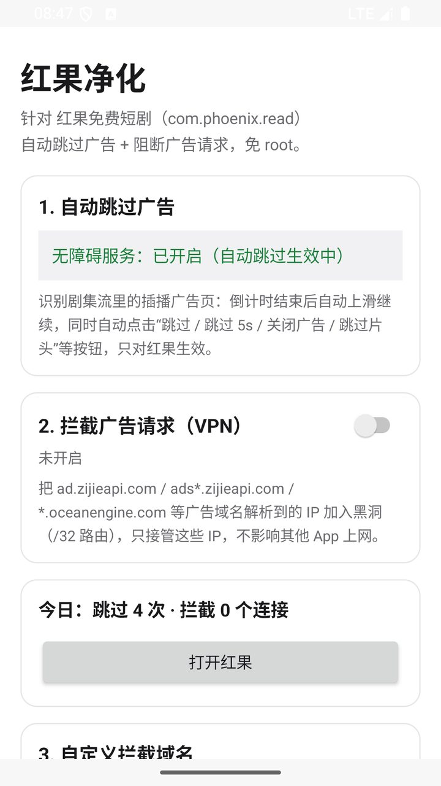

# 红果净化 · 红果短剧广告辅助（免 root）

一个不修改红果安装包、不需要 root 的外部辅助 App：用**无障碍服务**识别并跳过红果免费短剧（`com.phoenix.read`）剧集流里插播的整屏广告和各类「跳过 / 关闭」按钮，用**本地 VPN** 把广告域名解析出的 IP 全部拉黑。

- 包名：`com.hongguo.adblock`
- 版本：v1.1（versionCode 2），minSdk 26 / targetSdk 28，约 33 KB
- 直装包：<https://www.cniuu.com/dl/hongguo_adblock.apk>
- 下载页（含安装步骤、赞赏码）：<https://www.cniuu.com/dl/hongguo.html>



## 它解决什么问题

红果刷到第 7、8 集左右会插一条整屏广告页：倒计时期间 pager 被锁住滑不动，倒计时结束后底部才出现「上滑继续观看短剧」。v1.0 只会点带「跳过 / 关闭」字样的按钮，对这种页面无效，所以表现为「刷着刷着卡在广告上」。

v1.1 的做法是从反编译结果里找到这个页面的结构（见下文「逆向依据」），在提示文案出现的那一刻直接替你上滑翻页，并补全了按钮文案和右上角无文字关闭图标的识别。

## 功能

### 1. 无障碍自动跳过（只对红果生效）

- **插播广告页自动上滑**：读到「上滑继续观看短剧」立即上滑（2.5 秒冷却，避免连续误滑）。
- **按钮自动点击**：`跳过`、`跳过 5s`、`跳过广告`、`关闭广告`、`关闭此条广告`、`跳过片头` 等（700ms 冷却）。
- **右上角关闭图标**：广告页角落那种没有文案、自绘的关闭按钮，按「可点击 + 无文字 + 20~120dp + 位于屏幕右上 28%×30% 区域」识别后点击（1.2 秒冷却）。
- 只在 `com.phoenix.read` 的窗口事件里扫描，界面变化时做一次最多 5000 个节点的 BFS，两次扫描间隔 150ms。
- 主界面显示「今日：跳过 N 次」。

> 「跳过」文案匹配做了排除：`点击按钮关闭广告`、`点击右上角关闭` 这类**引导文案**本身不是按钮，点了会跳走，不识别为跳过。

### 2. 广告域名黑洞（可选，本地 VPN）

- 把从 dex 里提取的广告域名（`ad.zijieapi.com`、`ads3/ads5-normal*.zijieapi.com`、`*.oceanengine.com`、`csjdeveloper.com`、`scsjsd.com` 等，含穿山甲兜底域名）解析成 IP，逐条加 `/32`（IPv6 `/128`）路由到本地 TUN。
- 命中这些 IP 的 TCP 直接回 RST，UDP/ICMP 丢弃；**其他流量不受影响**（不是全局代理）。
- 每 10 分钟重新解析一次，应对 HTTPDNS 的 IP 轮换。
- 主界面显示「今日：拦截 N 个连接」，也能自己补充域名，重开 VPN 即生效。

完整域名列表见 [`AdHosts.java`](app/src/main/java/com/hongguo/adblock/AdHosts.java)。

## 安装

```bash
adb install -r dist/hongguo_adblock.apk
```

或者把 APK 传到手机点击安装（浏览器提示「未知来源」时允许）。

**Android 13 及以上**：旁加载后如果无障碍开关是灰的，去「设置 → 应用 → 红果净化 → 右上角 ⋮ → 允许受限设置」，再回来开启。

## 使用

1. 打开「红果净化」，点第 1 张卡片 → 系统无障碍设置 → 开启「红果广告自动跳过」。
2. （可选）打开第 2 张卡片的 VPN 开关，系统弹「连接请求」时点确定。状态栏会出现钥匙图标，这是 Android 对 VPN 的正常提示。
3. 从本 App 或桌面打开红果即可。

## 已验证（Android 11 / API 30 x86_64 模拟器）

- APK 安装、启动，中文界面正常。
- 无障碍服务可绑定（`canPerformGestures` 已开启，手势能真正发出）。
- 用同包名测试页（`com.phoenix.read`）模拟红果的三种插播广告形态，全部命中并留了日志与截图：
  - 整屏广告页倒计时结束后出现「上滑继续观看短剧」→ 自动上滑，日志 `swiped ad page: continue hint`，统计 +1（[test_swipe.png](dist/test_swipe.png)）。
  - 「关闭广告」按钮 → 自动点击，日志 `clicked ad button: 关闭广告`（[test_close.png](dist/test_close.png)）。
  - 右上角无文字关闭图标（自绘 View）→ 自动点击，日志 `clicked top-right close icon`（[test_icon.png](dist/test_icon.png)）。
- VPN：`tun0` 建立，解析出 66 条广告 IP 路由；向广告 IP 发包全部被吞，计数正常累加（[screen_stats.png](dist/screen_stats.png)）。
- **未在真机验证**：开发机未连真机，模拟器是 x86_64，而红果官方 APK 只带 arm64-v8a，装不上。真机上红果广告 SDK 实际渲染出的界面仍需实测；识别不到的界面形态可以按截图补规则。

## 逆向依据（红果 7.4.3.32）

| 现象 | 实现位置 |
| --- | --- |
| 剧集流插播广告容器 | `LandscapeOneStopView`（`com.bytedance.tomato.onestop`），广告内容为 LynxView |
| 倒计时期间锁滑动，结束后提示「上滑继续观看短剧」 | `os1.j`（倒计时结束回调，日志「横屏广告倒计时结束，可恢复滑动」）→ `ps1.a`（底部原生 TextView 设置文案） |
| 短剧贴片广告底部关闭按钮 | `PatchAdBottomContainer`：倒计时显示「N 秒后可继续看剧」，结束后显示「点击按钮关闭广告」+ 关闭/取消 |
| 广告域名 | `classes*.dex` 字符串里的 `ad.zijieapi.com`、`ads*-normal*.zijieapi.com`、`*.oceanengine.com` 等 |

资源名在红果里全部混淆（`layout/cxo`、`string/a44`），所以匹配一律按界面文案和控件几何位置做，不依赖资源 id。

## 源码结构

```
app/src/main/java/com/hongguo/adblock/
  AdSkipService.java        无障碍服务：BFS 扫描、按钮识别、上滑/点击手势
  AdBlockVpnService.java    本地 VPN：域名→IP→/32 路由黑洞
  AdHosts.java              广告域名清单
  MainActivity.java         界面、权限引导、统计
  Prefs.java                计数与开关持久化
app/src/main/res/           布局、样式、图标、无障碍配置
tools/                      手工打包辅助脚本（filelist / 注入 dex）
dist/                       成品 APK、下载页、验证截图
build.bat                   一键打包（aapt2 → javac → d8 → 注入 → 对齐 → 签名）
```

## 自己编译

需要：Windows、JDK 21、Android SDK（build-tools 36、platform android-28），路径写在 `build.bat` 顶部，双击运行，输出 `dist/hongguo_adblock.apk`。

流程是纯命令行工具链：`aapt2 compile/link` → `javac --release 8` → `d8` → 把 `classes.dex` 注入 `base.apk` → `zipalign` → `apksigner`。签名密钥 `keystore/hongguo.jks` 只在本地，已在 `.gitignore` 里排除；覆盖安装必须用同一签名。

## 已知限制

- 免 root 改不了红果本体，也不能 hook 它的广告 SDK，这是**外部辅助**方案。
- 插播广告的强制观看倒计时由红果自己计时，外部只能等它结束再自动上滑，**不能把 5 秒倒计时直接清零**。
- 广告页是纯视频 / 自绘界面、系统读不到任何文字和可点节点时，可能仍会漏过。
- 广告 SDK 走 HTTPDNS 会轮换 IP/CDN 节点，刷新间隔内可能有漏网；把新域名加进列表即可。
- 开屏 / 激励视频的跳过按钮若是自绘 View 或 WebView 内部元素，无障碍可能读不到文案（真机需实测）；识别不到时 VPN 仍会拦住广告请求。
- 拦截 `ad.zijieapi.com` 会连带拦掉激励视频的完成上报，可能影响「看广告送金币/权益」的到账。
- 同一时间只能开一个 VPN；部分手机省电策略会杀后台，建议把本 App 加入电池白名单。
- **不能替代红果会员的「免广告」权益。**

## 更新日志

- **v1.1（2026-11-21）**：新增插播广告页识别与自动上滑；新增右上角无文字关闭图标点击；补全「关闭此条广告 / 跳过广告」等文案；无障碍增加手势能力。
- v1.0（2026-11-21）：首个版本，跳过按钮自动点击 + 广告域名 VPN 黑洞。

## 赞赏

App 一直免费。如果它每天帮你省下几分钟，可以扫码请我喝杯咖啡。赞赏纯属自愿，不解锁任何功能，也与红果会员权益无关。

| 微信支付 | 支付宝 |
| :---: | :---: |
|  |  |
| 长按识别 / 扫码 | 长按识别 / 扫码 |

> 也可以在[下载页](https://www.cniuu.com/dl/hongguo.html)直接扫码。

## 免责声明

本项目仅供个人学习、研究与自用调试，不修改红果安装包、不破解会员权益、不绕过付费内容。请自行评估使用风险；因使用本工具产生的任何后果由使用者自行承担。如果红果官方提供更完善的免广告方案（会员），请优先使用官方方案。
